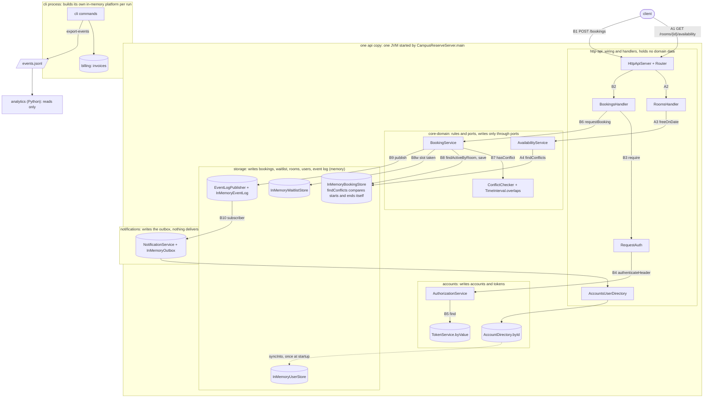

# BOUNDARIES.md

One section per milestone. Fill them in in order (the sketch before you write
anything about it, the copies next, the proposal last).

Draw Milestone 1's sketch from the code. A TA may ask where each arrow came
from.

Keep it short and specific. Point at modules, files, and callers.

---

## Milestone 1: The architecture as built

**The sketch.** Drawn from the wiring in `CampusReservePlatform` and the calls
under it. A cylinder is state that one copy holds in its own memory. `A1`–`A4`
is the availability path and `B1`–`B10` the booking path. The module edges
(poms and imports) match `AGENTS.md` rule 1 exactly, so the sketch draws
runtime calls rather than repeating them.

Where each arrow is in the code:

| Arrow | Code |
|---|---|
| wiring | `CampusReservePlatform` constructor, lines 44–58; routes, lines 153–158 |
| A2, B2 | `HttpApiServer.route`, lines 87 and 101 |
| A3 | `RoomsHandler.availability`, line 80 |
| A4 | `AvailabilityService.busyIntervals`, line 41, into `InMemoryBookingStore.findConflicts`, lines 55–63 |
| B3, B6 | `BookingsHandler.create`, lines 55 and 63 |
| B4, B5 | `RequestAuth.require`, line 30, into `AuthorizationService.authenticate`, line 43 |
| B7, B8 | `BookingService.requestBooking`, lines 112–113 and 124 |
| B8w | `BookingService.joinWaitlist`, line 332 |
| B9, B10 | `BookingService.requestBooking`, line 125, into `EventLogPublisher.publish`, lines 38 and 41; subscribed at `CampusReservePlatform`, line 58 |
| NS to AD | `CampusReservePlatform`, line 57 |
| syncInto | `CampusReserveServer.seed`, line 54, into `AccountDirectory.syncInto`, line 174 |
| cli | `CliContext`, lines 54–63; `ExportEventsCommand`, line 49 |
| billing on storage | `InMemoryInvoiceStore` extends `storage.InMemoryRecordStore` |

**Where your sketch and `ARCHITECTURE.md` disagree.**

1. `ARCHITECTURE.md` (lines 84–86) draws `TimeInterval.overlaps` as the only overlap implementation; the sketch's availability path (A1–A4) never reaches it and ends in a second one, `InMemoryBookingStore.findConflicts`. `ARCHITECTURE.md` does not draw the availability path at all.
2. `ARCHITECTURE.md` (lines 194–196) has the event log outliving a process through `JsonlFileEventLogWriter`; in the sketch no entry point builds that writer, and a running api copy logs to `InMemoryEventLog`, which is gone when the copy stops.
3. The sketch draws user data twice (`AccountDirectory.byId` and `InMemoryUserStore`), joined by one `syncInto` at startup; `ARCHITECTURE.md` draws neither the second copy nor the sync.

**How you decided which one is right.**

1. Read `InMemoryBookingStore.findConflicts` (lines 55–63): it tests
   `start.isBefore(windowEnd) && windowStart.isBefore(end)` inline and never
   calls `overlaps`. Listed its callers with
   `grep -rn findConflicts --include='*.java' */src/main`: the only production
   caller is `AvailabilityService` (lines 35 and 41), which
   `RoomsHandler.availability` reaches through `freeOnDate`. The two predicates
   agree today, and storage's `FindConflictsTest` pins that, including the
   half-open edges (lines 53 and 59) and a comparison against `overlaps`
   (line 99). `AvailabilityServiceTest`, though, runs on the test fake
   `core/support/InMemoryStores` (line 109), which does call `overlaps`, so the
   core-domain gate would not notice the storage copy drifting. The sketch is
   right; the documents state the rule, not the code.
2. `grep -rn "withEventLogFile\|new JsonlFileEventLogWriter" --include='*.java' */src/main`
   finds only the factory itself (`StoreRegistry`, lines 37–38). Both entry
   points call `StoreRegistry.inMemory()` (`CampusReservePlatform`, line 44;
   `CliContext`, line 54), and `CampusReserveServer.main` reads only a port,
   which is all the `Dockerfile`'s `CMD` passes. The CLI's `export-events` does
   write a file (`ExportEventsCommand`, line 49), but only from the platform
   that one CLI run built. The file writer ships and is tested, and nothing
   running uses it, so a booking made over HTTP never reaches `events.jsonl` or
   analytics. The sketch is right for the system as run.
3. `grep -rn "syncInto\|syncAccountsIntoBookingDomain" --include='*.java' */src/main`
   finds one call, in `CampusReserveServer.seed` (line 54), after the two
   seeded accounts are registered. Authentication reads `AccountDirectory`
   (`AuthorizationService`, line 53), while `BookingService.requestBooking`
   checks the booking domain's own `UserStore` (line 98). Both copies exist in
   the code, so the sketch is right to draw them.

---

## Milestone 2: Run it as copies

**Your stack.** The command that brought the stack up with two copies, and how
many distinct `X-Upstream` values your runs saw.

### Finding 1: tokens

**The claim.** One sentence, the one your script checks.

**The script and its result.** The file in `load/`, its threshold, and what a
run printed.

**Why, from the code.** The class that keeps tokens and how it is wired into
each copy. Say how you found it.

**The kind of problem.** Use the vocabulary from lecture.

### Finding 2: bookings

**The claim.**

**The script and its result.** Say how it reaches each copy directly, and why
it has to.

**Why, from the code.**

**The kind of problem.**

### What you checked

One thing your agent proposed that you checked (what it proposed, how you
checked it, and what came of it).

---

## Milestone 3: One boundary

Take one problem from Milestone 1 or 2 and propose the boundary that fixes it.

**The boundary.** The port, what it promises, and which side implements it. Say what
moves and what stays.

**Who owns the data.** Name the module that owns the data this boundary is about,
and say what everybody else is allowed to do with it.

**The one invariant that must not cross.** Exactly one, stated so that a reader
can tell whether a given piece of code violates it.

**What the boundary costs.** An interface to keep, a second implementation to
maintain, a performance argument to have again. Include what it leaves unfixed.

Feel free to read the appendix on what a good proposal looks like in the Lab 3 handout
before you write this section.
